# Mathaka (මතකය)

**A dementia-friendly medicine helper for older people in Sri Lanka.** Android first, Sinhala / Tamil / English. All AI runs **on the phones**, with open-weight models. There is no cloud.

> **A reminder is not remembering.** Alarm apps say *when*. Mathaka also answers *whether you already took it*, and stops a second dose.

> **Two open AIs. Gemma can see. Laya decides but cannot speak. Grandma only hears words her family wrote.**

**Status:** prototype for the DEV Hacktoberfest "Build for a Friend" challenge. **Not a medical device.** See [Honest limits](#honest-limits).

## Demo video (4.5 min)

[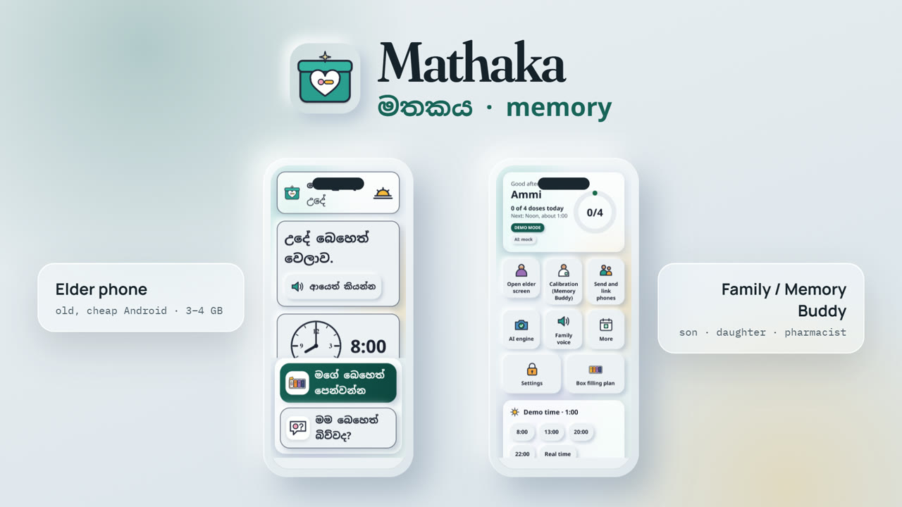](docs/media/mathaka-demo.mp4)

▶ **[Watch the demo (MP4)](docs/media/mathaka-demo.mp4)**. It covers the elder flow, the family phone, the on-device AI, pill vision, the Arduino box and the evaluation.
The video is made from HTML with [HyperFrames](https://hyperframes.heygen.com). Its source is in [`videos/mathaka-promo`](videos/mathaka-promo).

## Screenshots

Real screens from the web build (`npm run web`, demo mode).

**Elder phone**: one step at a time, the same calm words every time.

| Home (8:00) | This slot's pills | "Did you swallow them?" | "Did I take it?" |
|---|---|---|---|
| 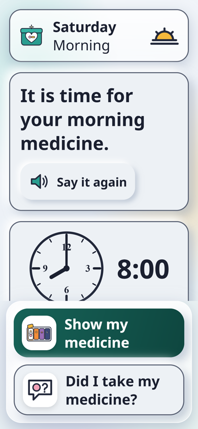 | 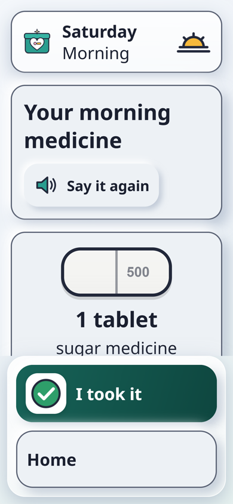 | 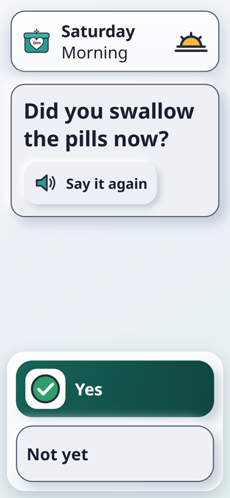 | 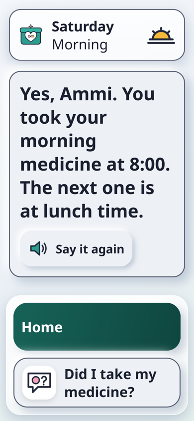 |

**Sinhala, Tamil and high contrast**

| සිංහල | தமிழ் | High contrast |
|---|---|---|
| 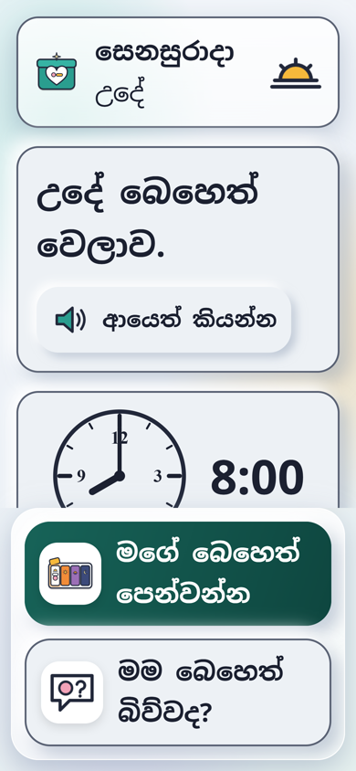 | 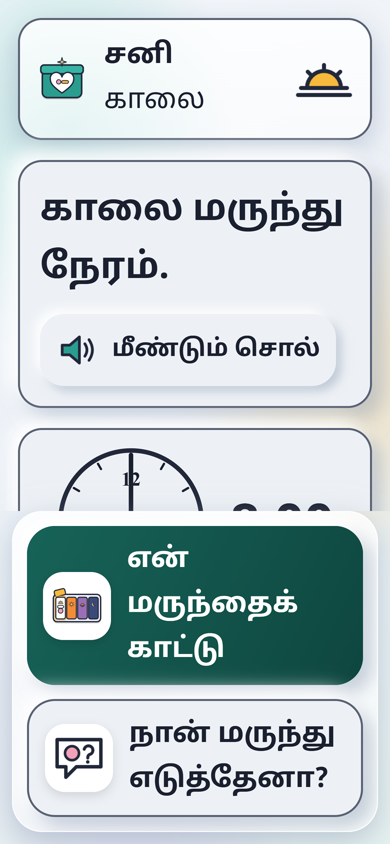 | 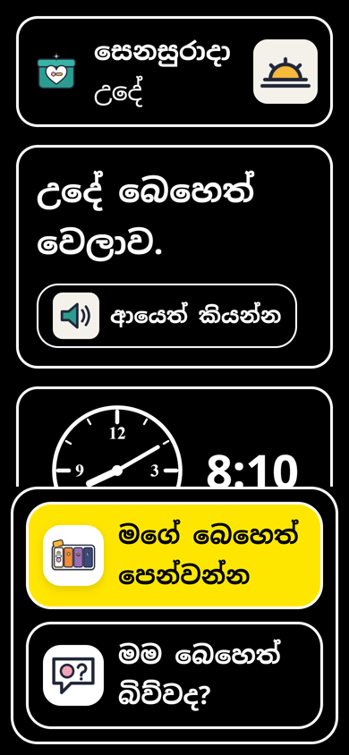 |

**Family / Memory Buddy phone**

| Dashboard | Week + stock | Calibration | Pill photo check |
|---|---|---|---|
| 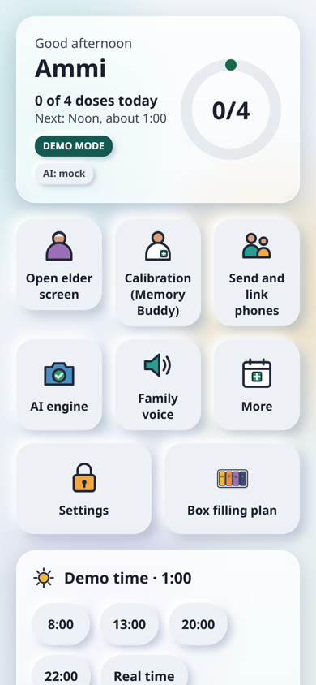 | 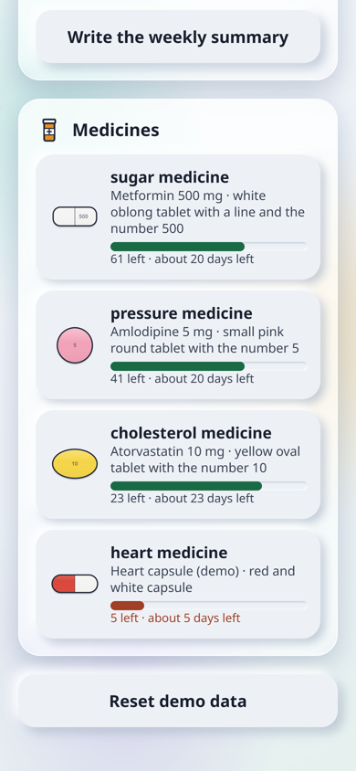 | 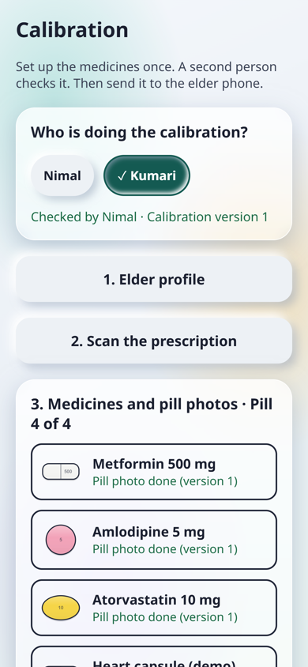 | 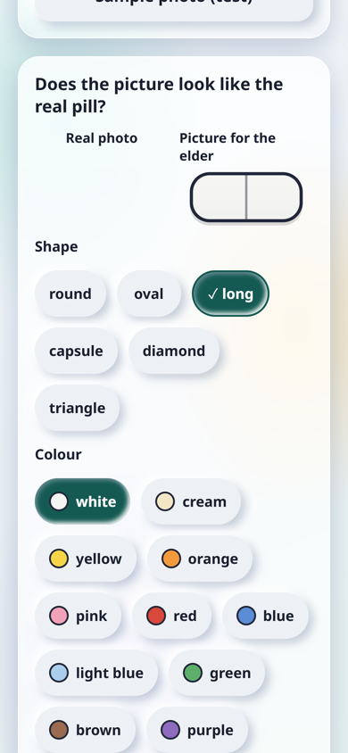 |

| Second-person check | Box filling plan | Family voice |
|---|---|---|
| 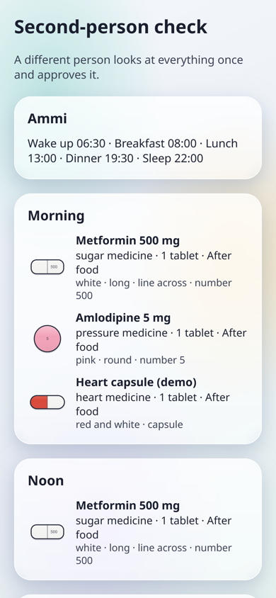 | 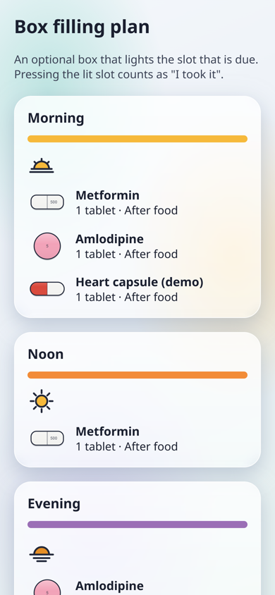 | 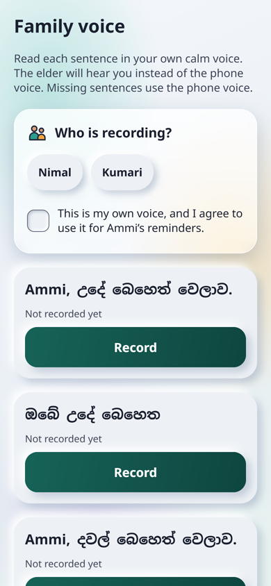 |

**Pill vision in plain TypeScript.** These are real outputs of `packages/core/src/vision`. It found the 4 markers, flattened the perspective, white-balanced on the grey patch and cut out the pill. Result: oblong, white, score line, **19.2 × 9.2 mm**, in about 200 ms.

| Photo on the mat | Seen from above (4 px/mm) | Pill segmented |
|---|---|---|
| 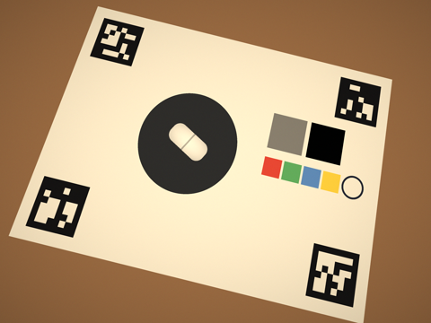 | 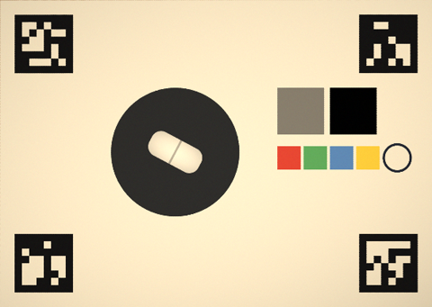 | 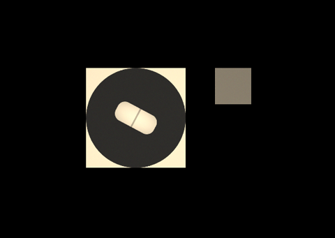 |

**From the video**

| | |
|---|---|
| 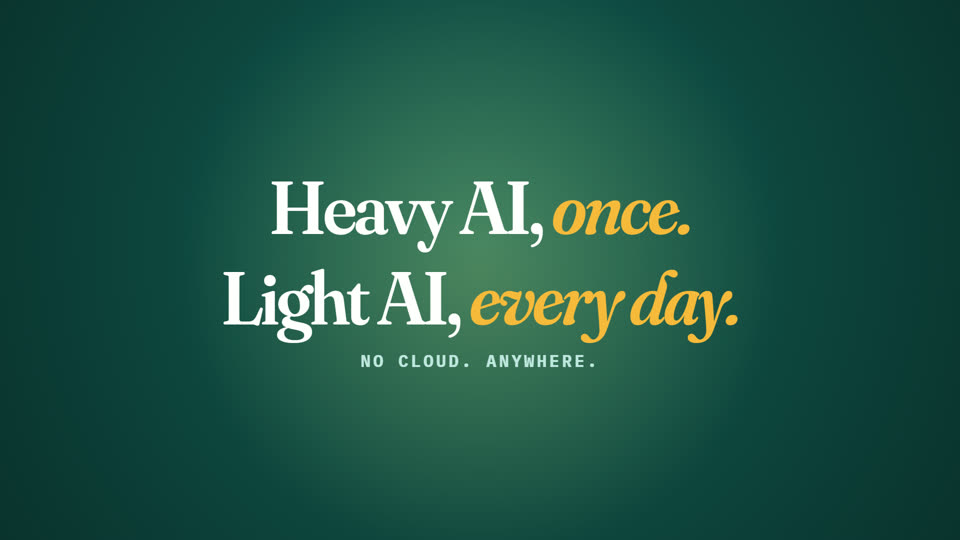 | 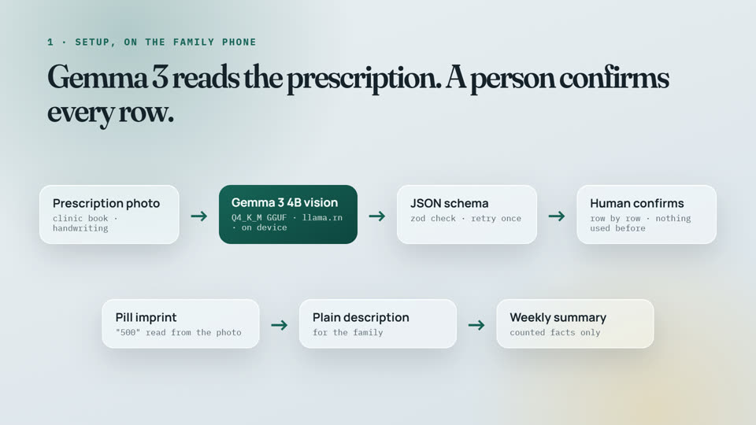 |
| 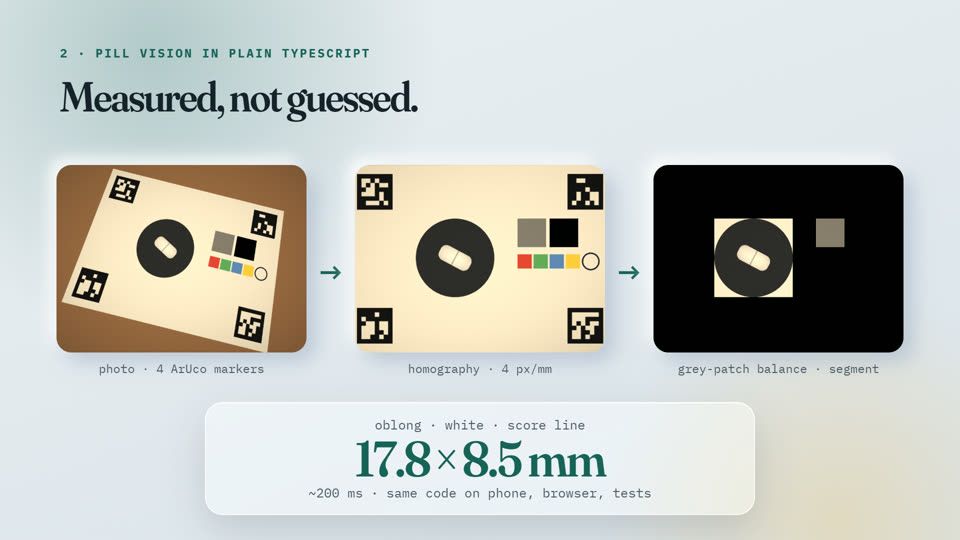 | 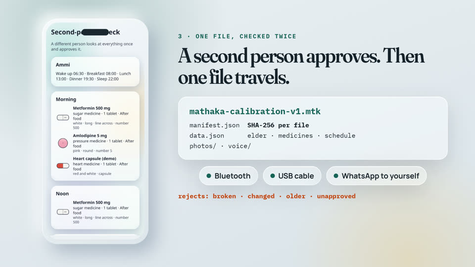 |
| 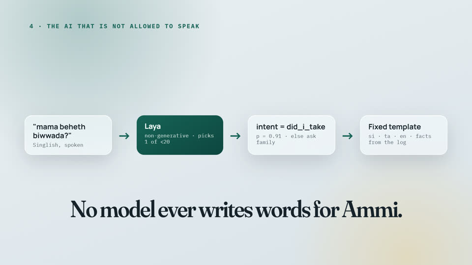 | 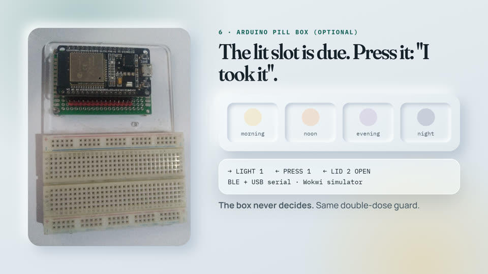 |
| 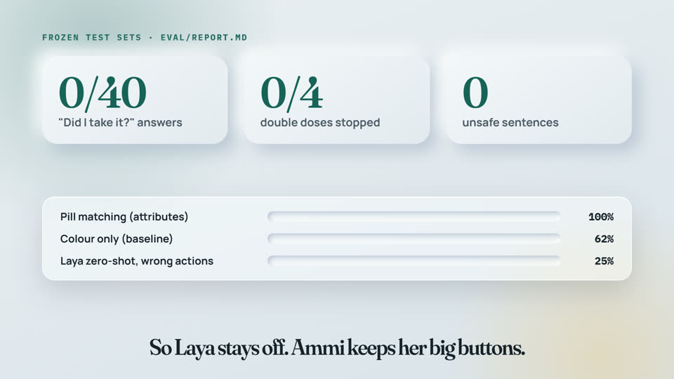 | |

## What it does

| For the elder (old, cheap phone) | For the family / Memory Buddy (any phone) |
|---|---|
| One gentle reminder in a familiar voice (family recording or phone TTS) | Calibrate once: scan the prescription, photograph each pill on the mat |
| Only this slot's pills, as big pictures, with their purpose, never drug names | Gemma 3 vision on the phone reads the prescription and the pill imprints |
| **"Did I take my medicine?"** answered from the log, the same calm words every time | Pure-TypeScript pill vision: size in mm, shape, colour, two-tone, score line |
| Double-dose guard ("You already took it at 8:05") | Look-alike warnings, box filling plan, **second-person approval** |
| "Check my pill" with the camera (a helper only, never the main ID) | One `.mtk` calibration file to the elder phone (hash-checked) |
| Orientation strip, analog clock, huge text, 7:1 contrast, high-contrast theme | Dashboard: today ring, alerts, week grid, stock, AI weekly summary |
| Evening calm mode, "Say it again", 1.5 s tap guard, no swipes | Alerts by home Wi-Fi or **SMS** (no internet needed) |
| Optional **Arduino pill box**: the due slot lights up; pressing it = "I took it" | Fridge card PDF, clinic date, refill alerts, benchmark screen |

## Repo layout

| Folder | What |
|---|---|
| `apps/mobile/` | Expo app (TypeScript, expo-router). One app, two roles. Local module `modules/mathaka-sms` (direct SMS). |
| `packages/core/` | Pure TypeScript shared by app + eval: schedule, dose guard, templates, pill vision, calibration file, box protocol. |
| `packages/laya-ts/` | Official Laya TypeScript runtime (vendored, Apache-2.0) + our DecisionEngine / ONNX provider. |
| `firmware/esp32/` | Arduino sketch for the pill box (ESP32, BLE + serial) + Wokwi diagram. |
| `helper/` | Optional laptop helper: FastAPI + Ollama (Gemma) + Laya, same JSON contracts. |
| `eval/` | Frozen test sets, `python -m eval.run`, results in `eval/runs/`, `eval/report.md`. |
| `tools/` | Asset generator, calibration mat (PDF/PNG), low chime, screenshots, laya-ts vendoring. |
| `docs/` | Architecture, models, EAS build, accessibility checklist, post draft, screenshots and demo video. |
| `videos/mathaka-promo/` | The demo video source (HyperFrames HTML scenes, voice, music, real app captures). |

## Quick start (Windows or macOS)

```sh
npm install
cp .env.example apps/mobile/.env      # PowerShell: Copy-Item .env.example apps/mobile/.env
npm run web                           # http://localhost:8081, Chrome F12 → Ctrl+Shift+M for phone size
```

- **Web preview:** storage is in memory, AI is a mock, and calibration has a "Sample photo (test)" button.
- **Expo Go on a phone:** run `npm start` and scan the QR code. The elder flow and reminders work.
- **The real app** (on-device Gemma, Bluetooth box, direct SMS, low chime) needs a free cloud build: [docs/eas-build.md](docs/eas-build.md).

## Checks

```sh
npm test                 # app (Jest) + core (node:test)
npm run typecheck && npm run lint
cd apps/mobile && npx expo-doctor
eval\.venv\Scripts\python -m eval.run --name mine     # then: python -m eval.report
```

## Results (from `eval/report.md`)

| Frozen test | Result |
|---|---|
| "Did I take it?" 40 hand-written cases | **40/40**, double doses stopped **4/4**, unsafe sentences **0** |
| Pill matching (synthetic photos) | **100%** known pills, **100%** new pills rejected (colour-only baseline 62% / 92%) |
| Laya zero-shot on Sinhala/Singlish (dev set) | not safe yet: elder phone keeps buttons; fine-tune prepared |

## Honest limits

- It is a prototype. **It is not a medical device** and has not been tested with doctors.
- Pill photos cannot safely identify a medicine; Mathaka only uses them as an extra check, after the schedule and the box slot.
- Sinhala speech recognition and TTS may be limited; the words are always on screen.
- Gemma vision needs a stronger phone; weak phones use the laptop helper for calibration.
- Pill-vision numbers are on synthetic photos so far; real photos are being collected.
- It does not replace a carer. It gives the carer one less worry.

## Video credits

- Voice: Kokoro-82M (`af_heart`, runs offline). Music: MusicGen small (offline). Both run on the laptop.
- Photos from Wikimedia Commons:
  - "Pills" by Ayena (public domain)
  - "Pill Organizer With Vitamins And Medicines" by Stevepb (CC0)
  - "Three generations" by trokilinochchi (CC BY 2.0)
  - "ESP32 Dev Board" by Edwiyanto (CC BY-SA 4.0)
  - The full list with links is in [`videos/mathaka-promo/assets/photos/credits.json`](videos/mathaka-promo/assets/photos/credits.json).
- Rebuild the video:
  1. `cd videos/mathaka-promo`
  2. `node scripts/build.mjs`
  3. `npx hyperframes render`

## Licence

The code is Apache-2.0. The vendored parts keep their own licences: js-aruco2 (MIT) and laya-ts (Apache-2.0). Model licences are listed in [docs/models.md](docs/models.md).
