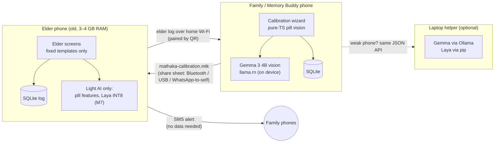

# Mathaka architecture

> Heavy AI once, light AI every day. No cloud.

## Decision layer: the AI that is not allowed to speak

- Every elder sentence is a fixed template () filled with data from the local log; a unit test forbids words like "take another", "wrong", "missed" and doses.
- Decisions only pick from short option lists (< 20): question intent, yes/no/unsure, frequency -> slots. Low confidence -> "Please wait. I will ask Nimal." + family alert.
- Engines:  (buttons only, elder default), Gemma (family phone), Laya (open, non-generative; vendored laya-ts runtime). Laya becomes the default only if it beats Gemma on Sinhala/Singlish **and** has a lower wrong-action rate. Zero-shot it does not (eval/report.md), so it waits for the Sinhala fine-tune.

## Optional Arduino pill box

ESP32 + 4 LEDs + 4 buttons or lid reed switches (). The phone sends  /  (max 1 Hz) /  over BLE; the box sends  / . The box never decides: a press on the current slot goes through the same double-dose guard as the screen; another slot only raises a quiet family alert. Same protocol over USB serial, so it runs in the Wokwi simulator.

## Calibration: one file, checked twice

- **Before export,** the family phone refuses to make a file unless a **second person** approved the calibration (`packages/core/src/calibrationFile.ts`).
- **The file** `mathaka-calibration-vN.mtk` is a zip: `manifest.json` (a SHA-256 for every file), `data.json` (elder, people, medicines, pill profiles, schedule, look-alikes, voice clips), `photos/*` and `voice/*`. The same calibration always gives the same bytes.
- **On import,** the elder phone checks every hash. It **rejects** a file that is broken or changed, a file that is not a calibration, a file in a newer format, an unapproved calibration, and a version that is **older or the same** as the one it has.
- **The import replaces** the elder profile, people, medicines, pills and schedule. The **dose log, alerts and questions stay**.
- **Check code:** both phones show the same 16-character code (from the file's SHA-256). The family phone also shows it as a QR, so people can compare by eye.
- **Moving the file:** any way that moves a file works (Android share sheet). There is no account, no server and no internet.

## Alerts: Wi-Fi first, SMS second, never a cloud

1. **Same Wi-Fi:** the family phone listens on port 8790 (`react-native-tcp-socket`). The elder phone was paired once by scanning a QR code (address + random token). After every change, the elder phone sends the last 7 days of its log as one JSON line. Merging is **idempotent** (by id), and the family's "read" marks are kept.
2. **No Wi-Fi link:** the elder phone sends a **short SMS** to family members with a phone number, using a tiny local Expo module (`apps/mobile/modules/mathaka-sms`, Android `SmsManager`). It works without mobile data.
3. **Retries:** undelivered alerts stay `pending`. They are retried when the app opens and by a background task (`expo-background-task`, at least every 15 minutes).

## Honest limits

- **The Wi-Fi link only works on the same network**, and only while the family phone's app is running. Android may stop it in the background. SMS covers the gap.
- **`react-native-tcp-socket` is marked "untested on New Architecture"** (React Native Directory). It is loaded lazily, so if it fails, the Wi-Fi link is simply off and SMS is used.
- **Direct SMS needs the `SEND_SMS` permission.** Google Play restricts this permission, which is fine for a sideloaded APK. In Expo Go there is no direct SMS, so alerts wait for Wi-Fi.
- **SMS costs** the normal SMS price. Sinhala and Tamil messages use Unicode, so one alert may be 2–3 SMS parts.
- **Missed-dose checks when the app is closed run on Android's schedule** (every 15 minutes or later, not exact). The reminders themselves are exact local notifications.
- **In demo mode, SMS is OFF by default,** because the demo phone numbers are not real.
